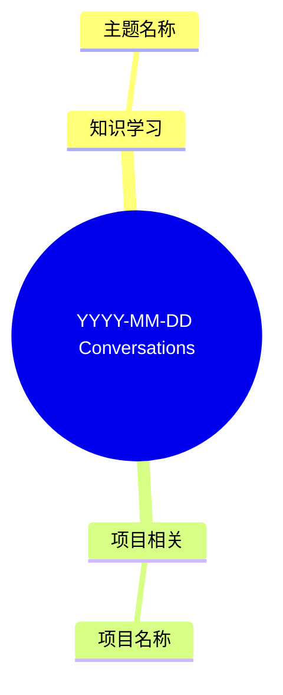

# Conversation Obsidian Diary

Turn AI conversations into two coordinated Obsidian outputs:

1. A date-based daily review of what happened.
2. Topic- or project-based notes for knowledge worth keeping.

The daily note is the timeline. The second brain is the durable retrieval system.

## Before Writing

Resolve the vault path, target date, timezone, second-brain root, and attachment folder. Use explicit user instructions first. If configuration is missing, read [references/configuration.md](references/configuration.md).

Obtain a normalized Markdown transcript. When the conversation source needs conversion, read [references/transcript-format.md](references/transcript-format.md):

- Codex JSONL sessions: run `scripts/extract_codex_day.py`.
- Generic JSON exports: run `scripts/normalize_transcript.py`.
- Other platforms: convert their export to the documented normalized Markdown contract without changing the source data.

Never upload conversations, notes, or attachments. Work locally unless the user explicitly authorizes an external destination.

## Output Model

Consider every substantive interaction for the daily note. Add only durable material to the second brain.

- **Daily note:** what happened, what was accomplished, and what mattered that day.
- **Second brain:** reusable knowledge, decisions, project progress, troubleshooting patterns, and material worth revisiting.
- **Daily-only:** one-time execution whose value is mainly that it happened.

Use daily-only for file moves, one-off installations, temporary service checks, and similar actions. Promote an item to the second brain when it creates a reusable workflow, records a likely recurring constraint, teaches a transferable concept, advances a long-running project, or the user asks to preserve it.

## Classification

Assign exactly one primary category. Add related categories only when they improve retrieval.

### 知识学习

Concepts, explanations, technical understanding, general methods, and capability building. Use this when the main intent is understanding what something is, why it works, or how to learn it.

### 项目相关

Use only for explicitly identified work, internship, company, research, or other long-running projects. Coding alone does not make something a project record.

Include:

```markdown
- 项目：...
- 工作类型：需求分析 / 开发实现 / 调试排障 / 文档记录 / 会议沟通 / 进度复盘 / 其他
- 今日进展：...
- 阻塞问题：...
- 下一步：...
```

If the context is clearly project-related but no name is available, write `项目：待识别`. Never invent a project name.

### 操作实践

Tool operation, configuration, local or remote environment maintenance, practical troubleshooting, and personal workflow systems. Tool setup and Obsidian vault maintenance normally belong here even if they contain some conceptual explanation.

### 个人成长

Reflection, habits, planning, career development, communication, emotional regulation, and personal workflow improvement.

### 学术研究

Papers, literature reviews, courses, theories, experiments, academic writing, and research plans.

For a specific paper, report, manual, standard, or named document, create or update one second-brain note for that document. Do not merge unrelated documents into a generic reading bucket. When comparing documents, keep one durable note per document and cross-link them.

### 生活事务

Non-work, non-academic, non-technical matters such as errands, travel, consumption decisions, reminders, and ordinary communication.

### 待澄清

Use when the content is too short or ambiguous to classify reliably.

## Classification Order

Decide using:

1. User intent.
2. Conversation outcome.
3. Explicit work, academic, life, or project context.
4. Where the user would naturally retrieve it later.
5. Keywords only as supporting evidence.

For non-obvious choices, include a short `判定依据`. Do not use `项目相关` as a general engineering bucket.

## Topic Selection

For each durable item, choose one primary second-brain target in this order:

1. An existing matching topic or project note.
2. The user's explicit project or topic name.
3. The exact named paper or document for document-centered academic work.
4. A clear reusable domain topic.
5. A concise new topic name.

Prefer broad reusable topics such as `Git.md`, `Obsidian.md`, or `Agent 工作流.md` over one-note-per-question fragmentation. A specific paper or named document is intentionally an atomic note. If an item spans topics, store the full entry once and add links instead of duplicating it.

## Paths, Links, and Tags

Organize durable notes below the configured second-brain root:

```text
<second-brain-root>/
  知识学习/
  项目相关/
  操作实践/
  个人成长/
  学术研究/
  生活事务/
```

Use paths for category, titles for concrete topics, wikilinks for relationships, and tags only for cross-cutting filters that cannot be inferred from path or title.

Daily notes use:

```yaml
tags:
  - daily
```

Do not add generic category or topic tags to second-brain notes. Useful optional tags include `用途/面试`, `能力/agent`, or `状态/待复习` when the conversation clearly supports them.

Put all note images under the configured attachment folder and embed them with Obsidian wikilinks. Do not scatter attachments beside topic notes.

## Safe Update Rules

Preserve all user-authored content outside managed markers.

Use this pair in the daily note:

```markdown
<!-- conversation-diary:start -->
...
<!-- conversation-diary:end -->
```

Use one date-specific block in a second-brain note:

```markdown
<!-- conversation-learning:YYYY-MM-DD:start -->
...
<!-- conversation-learning:YYYY-MM-DD:end -->
```

If rerunning for the same date, replace that date's managed block rather than appending a duplicate. Create a backup before modifying a note when markers are malformed, nested, repeated unexpectedly, or ambiguous. Stop and ask the user instead of overwriting uncertain content.

## Workflow

1. Resolve configuration and read the normalized transcript.
2. Ignore system prompts, tool logs, hidden instructions, sandbox noise, and repeated progress updates unless the user learned from or decided something about them.
3. Identify substantive interactions and classify each one.
4. Mark each item `daily-only` or `daily + second-brain`.
5. Update the managed daily block.
6. Update one durable topic or project note for every `daily + second-brain` item.
7. Link the daily note only to durable notes updated for that day.
8. Verify that content outside managed markers is byte-for-byte preserved when practical.

## Daily Note Shape

Omit empty categories unless the user requests a fixed template.

~~~markdown
---
date: YYYY-MM-DD
tags:
  - daily
---

<!-- conversation-diary:start -->
# YYYY年MM月DD日回顾

## 知识学习
### 主题名称
- 归档主题：[[<second-brain-root>/知识学习/主题|主题]]
- 判定依据：...
- 可复习问题：...

## 项目相关
### 主题名称
- 项目：...
- 工作类型：...
- 今日进展：...
- 阻塞问题：...
- 下一步：...
- 判定依据：...

## 今日第二大脑归档索引
- [[<second-brain-root>/知识学习/主题|主题]]

## Mindmap

<!-- conversation-diary:end -->
~~~

## Second-Brain Note Shapes

Topic note:

```markdown
# Topic

<!-- conversation-learning:YYYY-MM-DD:start -->
## YYYY-MM-DD

- 内容摘要：...
- 关键理解：...
- 可复习问题：...
- 来源日记：[[YYYY-MM-DD]]
- 相关主题：[[Related Topic]]
<!-- conversation-learning:YYYY-MM-DD:end -->
```

Project note:

```markdown
# Project

<!-- conversation-learning:YYYY-MM-DD:start -->
## YYYY-MM-DD

- 今日进展：...
- 工作记录：...
- 阻塞问题：...
- 下一步：...
- 来源日记：[[YYYY-MM-DD]]
<!-- conversation-learning:YYYY-MM-DD:end -->
```

## Quality Checks

- Write in the user's preferred language; otherwise match the transcript language.
- Summarize instead of copying full conversations.
- Keep daily bullets compact and reviewable.
- Separate observed facts, user decisions, and agent suggestions.
- Do not invent project names, outcomes, metrics, or decisions.
- Verify all wikilink targets and managed markers before finishing.
- Report which files were created or updated and which items remained daily-only.
